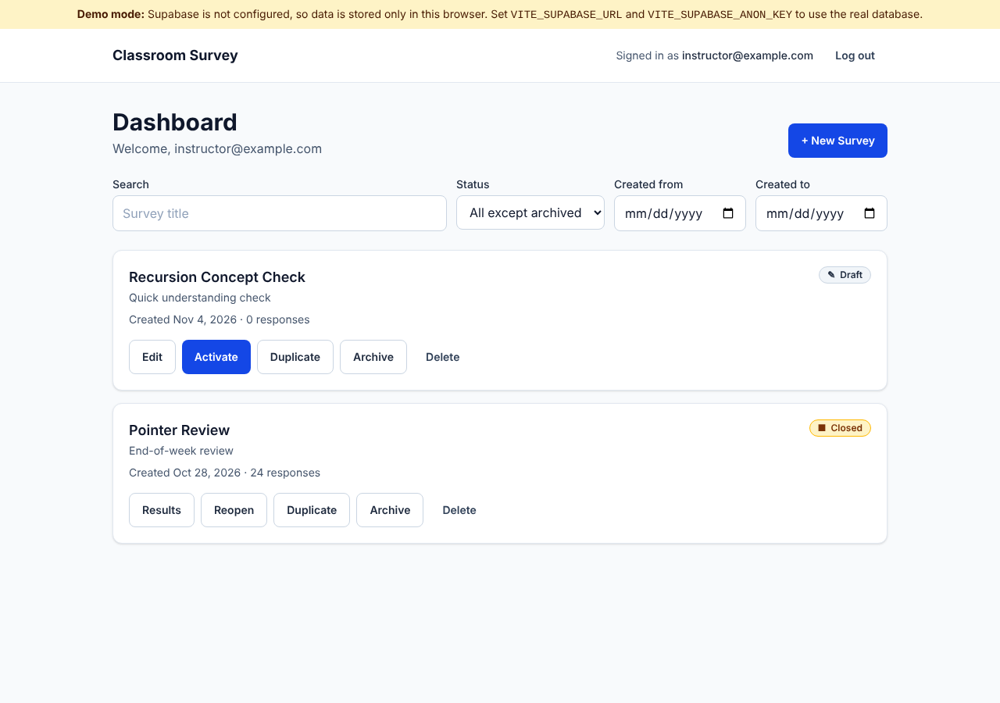
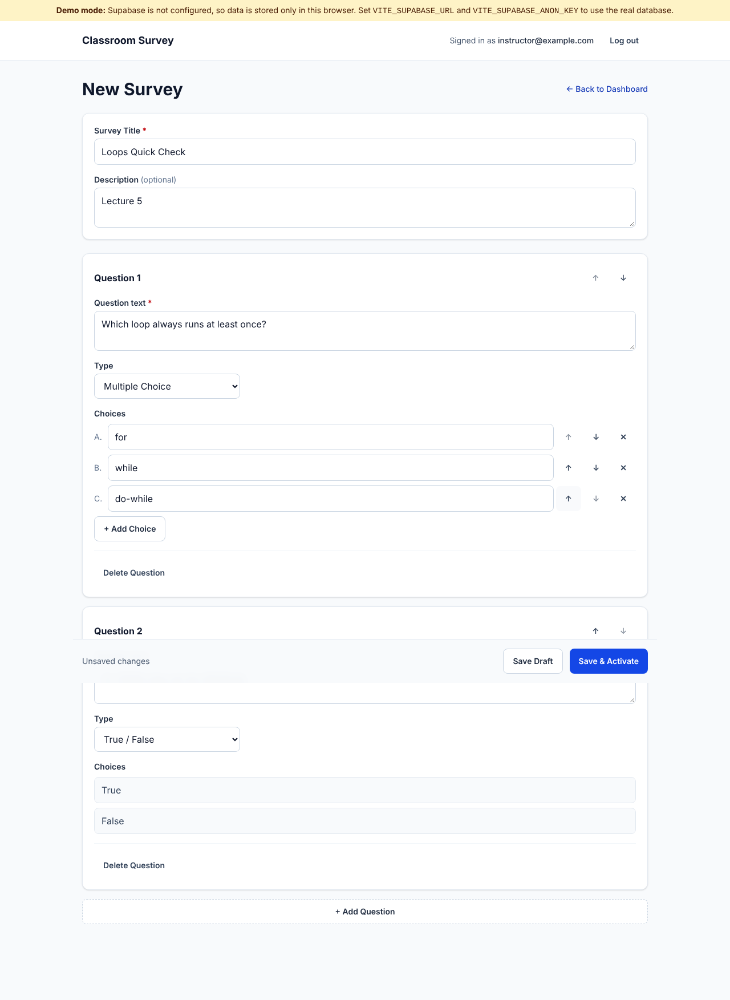
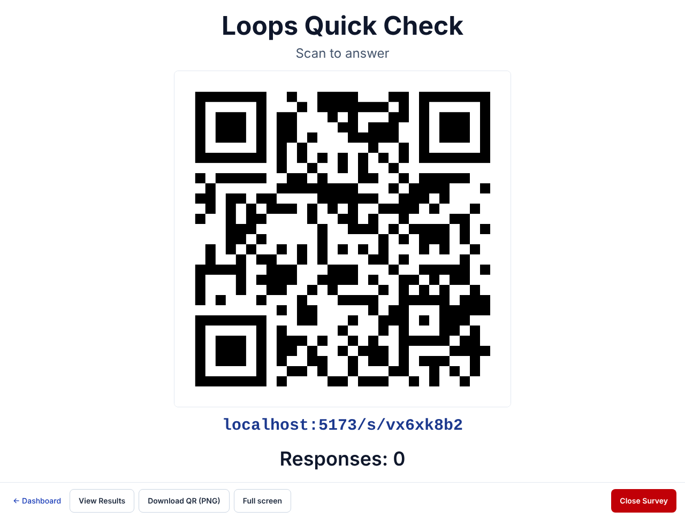
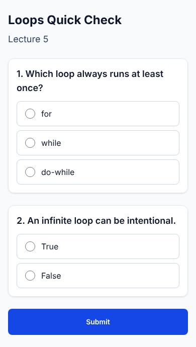
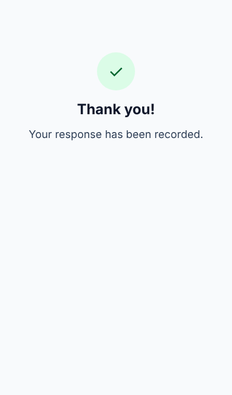
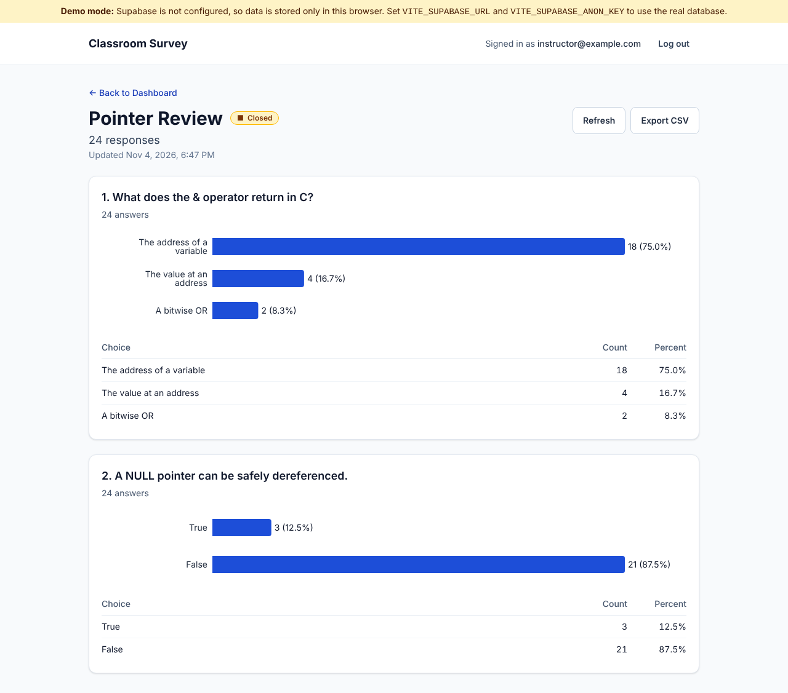

# Classroom Survey

Quick in-class understanding checks. Instructors create a survey, show a QR code, and
students answer from their phones with no login required. Results show counts,
percentages and charts, and can be exported as CSV.

**Stack:** React 19 + TypeScript + Vite, Tailwind CSS v4, React Router, Supabase
(PostgreSQL + Auth), Recharts, `qrcode`. Hosted on Cloudflare (Workers static assets).

Specifications: [SPEC.md](SPEC.md), [docs/API.md](docs/API.md),
[docs/DATABASE.md](docs/DATABASE.md), [docs/UI.md](docs/UI.md), [TODO.md](TODO.md).
Design decisions: [docs/PHASE1_REVIEW.md](docs/PHASE1_REVIEW.md).
Supabase setup: [docs/SUPABASE_SETUP.md](docs/SUPABASE_SETUP.md). Workflow test results: [docs/PHASE4_TESTING.md](docs/PHASE4_TESTING.md). Test & debug report: [docs/PHASE5_TESTING.md](docs/PHASE5_TESTING.md). Deployment: [docs/DEPLOYMENT.md](docs/DEPLOYMENT.md).

## Run locally

```bash
npm install
npm run dev          # http://localhost:5173
```

### Demo mode vs. Supabase

The app picks its backend from environment variables:

| `.env` | Backend | Data |
|---|---|---|
| `VITE_SUPABASE_URL` and `VITE_SUPABASE_ANON_KEY` **empty** | **Demo mode**: in-browser backend (`src/lib/api/demoApi.ts`) | Kept in this browser's `localStorage` only, with sample surveys |
| Both set (copy `.env.example` → `.env`) | Supabase (`src/lib/api/supabaseApi.ts`) | Your Supabase PostgreSQL database |

Demo login: **`instructor@example.com` / `demo1234`**. A yellow banner shows when demo
mode is on. Demo mode follows the same rules as the database: one active survey at a
time, only drafts are editable, one response per browser. Because demo data lives in a
single browser, a student phone can't reach it; test student pages in another tab of the
same browser. To reset the demo data, clear the site's local storage.

### Connecting to Supabase

Follow **[docs/SUPABASE_SETUP.md](docs/SUPABASE_SETUP.md)**. In short: create a project,
run the three SQL files in `supabase/migrations/` in the SQL Editor, run
`supabase/verify/01_security_checks.sql` (every row should say PASS), disable public
sign-ups, create your instructor user, then put the Project URL and **anon/publishable**
key in `.env`.

> Only public values go in `.env`. Never commit `.env`, the database password, or a
> `service_role` / `sb_secret_` key. The app refuses to start with a secret key, and a
> production build without Supabase settings shows a configuration error instead of
> running in demo mode.

## Scripts

| Command | Purpose |
|---|---|
| `npm run dev` | Dev server |
| `npm run dev:lan` | Dev server on your network address, so phones on the same Wi-Fi can scan the QR code |
| `npm run build` | Type-check and production build to `dist/` |
| `npm run preview` | Serve the production build |
| `npm run lint` | ESLint |
| `npm run format` | Prettier |
| `npm test` | Vitest unit tests (CSV, results maths, validation, error mapping, config, demo backend rules) |
| `npm run test:integration` | Phase 4 workflow against the live Supabase project via the app's data layer (needs `.env` + `E2E_INSTRUCTOR_*`) |
| `npm run test:e2e` | Same workflow through the real UI in a browser, checking the database at every step |
| `npm run test:phase5` | 26 test-and-debug scenarios (QR, submissions, persistence, errors, devices) against live Supabase |
| `npm run test:db` | Apply migrations to a disposable local Postgres and run the security checks (`TEST_DATABASE_URL=...`) |

## Pages

| Route | Page | Access |
|---|---|---|
| `/` | Landing | Public |
| `/login` | Instructor login | Public |
| `/dashboard` | Survey list: search, status and date filters, Edit / Activate / Close / Duplicate / Archive / Delete | Instructor |
| `/surveys/new`, `/surveys/:id/edit` | Editor: Multiple Choice and True/False questions, reorder, validation (drafts only) | Instructor |
| `/surveys/:id/present` | Projector view: large QR code, URL, live response count (5 s polling), PNG download, full screen, Close | Instructor |
| `/surveys/:id/results` | Counts, percentages, bar charts, refresh, CSV export | Instructor |
| `/s/:slug` | Student survey (mobile first, no login) | Public |

## Project structure

```text
src/
  components/   Shared UI (buttons, dialogs, badges, layout, chart, route guard)
  pages/        One file per route
  lib/
    api/        SurveyApi interface + Supabase and demo implementations
    auth.tsx    Auth context/provider
    csv.ts      CSV generation (RFC 4180, formula-injection safe, Excel BOM)
    results.ts  Results aggregation
    validation.ts, errors.ts, token.ts, config.ts, ...
wrangler.jsonc      Cloudflare Workers deploy config (SPA routing)
supabase/
  migrations/       Schema, RLS policies, database functions (run in order)
  verify/           Security checks and data-inspection queries for the SQL Editor
  seed.sql          Optional sample survey
  tests/            Local stand-in for Supabase roles (testing only)
scripts/test-db.sh  Local database test runner
docs/               Specifications, design review, screenshots
```

## Screenshots

| Dashboard | Editor | Present |
|---|---|---|
|  |  |  |

| Student (phone) | Confirmation | Results |
|---|---|---|
|  |  |  |
